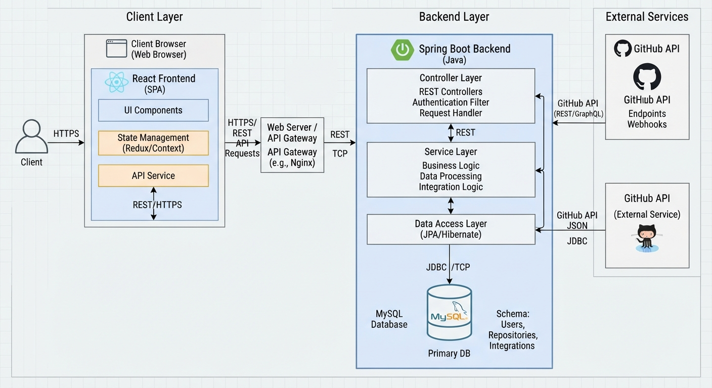

# LLM Handoff

A workspace for building and storing project manifests — structured JSON documents that capture a project's overview, environment, commands, architectural decisions, rules, and open questions — and rendering them into context handoff prompts for LLM coding assistants.

## Docs

- [Architecture Decision Records](docs/Architecture-Decision-Record) — ADR-001 dual-stage JSON storage, ADR-002 MySQL-only test database
- [Observability roadmap](docs/observability-roadmap.md)
- [System architecture diagram](docs/handoff-architecture.jpg)

## Tech Stack

- **Frontend:** React SPA served behind Nginx, talking to the backend over REST/HTTPS
- **Backend:** Java + Spring Boot, layered as Controller → Service → Data Access (JPA/Hibernate); GitHub OAuth login
- **Database:** MySQL (primary store for users, repositories, integrations, and manifests), migrations via Flyway
- **External services:** GitHub API (REST/GraphQL + webhooks) for repository sync
- **Observability:** Prometheus scraping the Spring Boot actuator, Grafana dashboards
- **Runtime:** Docker Compose services; Nginx reverse proxy with TLS in production

## Data Flow (user request → database update)

1. The user's browser sends an HTTPS request to the Nginx web server.
2. Nginx proxies the request to the Spring Boot REST controller.
3. The authentication filter verifies the user's GitHub OAuth session.
4. The controller delegates to the service layer, which validates the payload (e.g., manifest JSON is deserialized into typed `ManifestData` records) and applies business logic.
5. The data access layer (JPA/Hibernate repositories) maps the operation to SQL over JDBC.
6. MySQL persists the change — e.g., a new immutable `manifests` row containing the raw JSON.
7. Where repo data is involved, the service layer calls the GitHub API first, then stores the result the same way.
